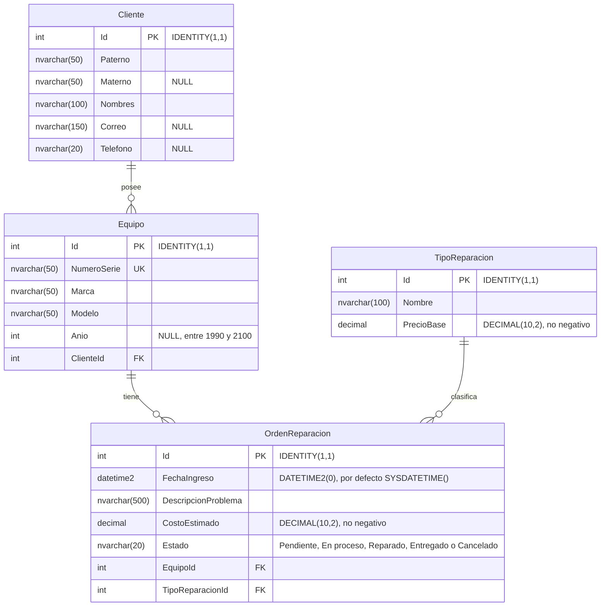

# Diagrama entidad-relación

Modelo de la base de datos `ServicioTecnicoDB`, definido en [ServicioTecnicoDB.sql](ServicioTecnicoDB.sql). GitHub
muestra el diagrama al abrir este archivo. Para verlo en https://mermaid.live, pegue solo el código del diagrama,
desde la línea erDiagram hasta la última llave, sin las líneas de apertura y cierre del bloque.

| Relación | Cardinalidad | Clave foránea |
|---|---|---|
| Cliente y Equipo | Un cliente tiene cero o más equipos; cada equipo pertenece a un cliente. | `FK_Equipo_Cliente` |
| Equipo y OrdenReparacion | Un equipo tiene cero o más órdenes; cada orden corresponde a un equipo. | `FK_OrdenReparacion_Equipo` |
| TipoReparacion y OrdenReparacion | Un tipo de reparación clasifica cero o más órdenes; cada orden tiene un tipo. | `FK_OrdenReparacion_TipoReparacion` |
